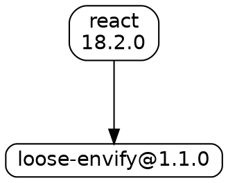

# Этап 5. Визуализация графа зависимостей (Вариант №8)

## Описание реализации

Для визуализации построенного графа зависимостей реализован модуль
`src/visualizer.py`, который выполняет два шага:

1. **Генерация DOT-кода:** функция `generate_dot_source` преобразует
   словарь смежности в текстовое описание ориентированного графа на языке
   `Graphviz`. Для читаемости используются направление сверху вниз
   (`rankdir="TB"`), ортогональные линии (`splines="ortho"`) и многострочные
   подписи узлов с указанием имени и версии пакета.
2. **Рендеринг в SVG:** функция `render_svg` передает сгенерированный
   DOT-текст на стандартный ввод утилиты `dot -Tsvg` и сохраняет итоговое
   векторное изображение в файл, заданный параметром `output_file`.

Пример сгенерированного фрагмента на языке DOT:

## Примеры визуализации для трех различных пакетов

Проверка генерации SVG-диаграмм проведена на трех популярных пакетах из
реестра `https://registry.npmjs.org` при `max_depth = 2` и пустом фильтре:

1. **`express@4.19.2`** — разветвленный граф с большим количеством прямых
   зависимостей (`body-parser`, `accepts`, `finalhandler`, `send`, `debug`
   и др.) и общими транзитивными узлами.
2. **`react@18.2.0`** — компактный граф с минимальной цепочкой зависимостей
   (`react` -> `loose-envify` -> `js-tokens`).
3. **`lodash@4.17.21`** — граф из одного корневого узла, так как библиотека
   не имеет внешних зависимостей (zero-dependency).

## Сравнение со штатными инструментами визуализации

При сравнении полученных SVG-графов с выводом штатной команды менеджера
пакетов `npm ls --all` наблюдаются следующие закономерные расхождения:

1. **Хоистинг (поднятие зависимостей):** `npm` оптимизирует дерево установки
   в папке `node_modules`, поднимая общие транзитивные пакеты на верхний
   уровень и помечая повторы флагом `deduped`. Инструмент строит чистый
   ориентированный граф связей между пакетами без файловой оптимизации.
2. **Разрешение диапазонов SemVer и lock-файлы:** менеджер вычисляет
   наиболее свежие совместимые версии по диапазонам (`^`, `~`, `>=`) и
   опирается на `package-lock.json`. Инструмент извлекает базовую версию
   формата `X.Y.Z` напрямую из манифеста реестра.
3. **Учет типов зависимостей:** анализатор обрабатывает только секцию
   `dependencies`. Инструмент при установке может дополнительно
   подтягивать `peerDependencies`, `optionalDependencies` и `devDependencies`.
4. **Ограничение глубины и фильтрация:** в программе обход строго
   ограничен параметром `max_depth` и фильтром `filter_substring`, тогда как
   `npm ls --all` выводит дерево на всю доступную глубину.
5. **Отображение циклов:** при наличии циклических зависимостей алгоритм
   итеративного DFS фиксирует ребро в графе и предотвращает повторный обход
   через множество `visited`, а `npm` разрывает цикл при построении дерева.